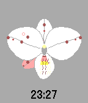

# Orchid Clock

A native Pebble watchface. A moth orchid keeps time in its markings.



Twelve freckles across the wings fill for the hour. Sixty tiny spots settle
along the lower petal for the minutes, and nectar fills the throat over each
minute. Noon and midnight fill all twelve hour freckles; the minute spots
clear at the start of each hour.

Color watches show white petals, blush pink and gold nectar. Monochrome
watches show a white flower with dark marks on black. The face updates once a
second, pauses drawing when another app covers it, and needs no phone
connection or account to tell time.

A small digital clock sits at the bottom by default and follows the watch's
12/24-hour setting. To show the flower alone, turn off **Bottom digital clock**
in the face's settings in the Pebble phone app. The watch remembers the choice.

## Watches

| Platform | Watch | Display |
| --- | --- | --- |
| basalt | Pebble Time, Time Steel | 144 × 168, color |
| chalk | Pebble Time Round | 180 × 180, color, round |
| diorite | Pebble 2 | 144 × 168, monochrome |
| emery | Pebble Time 2 | 200 × 228, color |
| flint | Pebble 2 Duo | 144 × 168, monochrome |
| gabbro | Pebble Round 2 | 260 × 260, color, round |

## Install

Orchid Clock has no standalone Pebble Appstore listing. The orchid design is
also one of the options in the separate
[Flower Clocks](https://apps.repebble.com/080beb8c62d7416daa2d820e) face.

The source here is version 1.0.2. `release/` holds the 1.0.0 and 1.0.1 PBWs
with source ZIPs and SHA-256 checksums; 1.0.1 has no digital clock. To get
1.0.2, build it from source.

## Build and test

Install the Pebble command-line tool with SDK 4.33.1. Host checks need a C
compiler (Clang by default), Python 3 and Pillow. The checked-in artwork is
enough for a normal build.

```sh
make test
pebble build --sdk 4.33.1
```

Pebble names the output after the project directory: in a directory named
`orchid-clock`, it is `build/orchid-clock.pbw`. `make assets` regenerates the
geometry and artwork from the source shapes. `node tools/source-fixtures.mjs`
recaptures the geometry fixtures from the original HTML; normal builds don't
need Node.js.

The emulator scripts need the Python environment that has `pebble-tool`. Run
the capture once per platform, then package and rebuild from the source ZIP:

```sh
python test/emulator.py chalk --fresh
python test/package.py
python test/independent.py
```

Packaging expects reports for all six platforms from the same PBW. The
captures check installation, changing time, natural noon and midnight
rollovers, and one-second updates. [evidence/](evidence/) holds the reports
and screenshots. Build logs in earlier commits contain absolute paths from the
original build machine.

## How the port works

I made the original [Orchid Clock](https://datapoems.io/clocks/orchid-clock/)
as a web clock. Its HTML and a screenshot are in [reference/](reference/), and
[provenance.json](reference/provenance.json) records their hashes.

The watchface keeps the original Bézier wing and lower-petal shapes, the
twelve hour positions and the five rows of twelve minute spots. The flower
scales to fit each screen, and all 72 mark centers stay distinct at every
native resolution. Host checks compare each mark position with fixtures
captured from the source, verify the compiled coordinate tables, and check
the nectar mask pixel by pixel, including the clear center column.

Pebble's palette reduces the soft gradients to white, gray, pink and gold.
Monochrome uses filled and outlined hour freckles. A clipped nectar fill shows
the fraction of the current minute at one-second resolution. The watch drops
the browser version's grain, shadows, continuous motion and palette cycling.
The static flower streams from flash one row at a time through a 260-byte
buffer; the time markings are drawn on the watch.

The package UUID is `f7009e56-3676-4fec-b78a-4bef6019d2e8`. Keep it unchanged
for updates.

## License

Copyright 2026 Luke Steuber. [MIT License](LICENSE). The digital clock uses
Pebble's built-in Gothic system font; no third-party fonts, images or code are
bundled.
